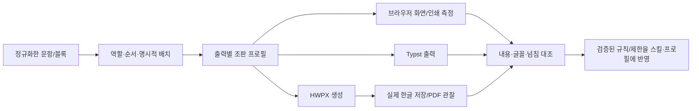

# H1-e — 한글 분석을 사이트 시험지 조판에 적용하기

- 날짜: 2026-10-15 · Codex 주도 조사/설계
- 상태: **코드/자체 브라우저 조사·Claude 독립 검토 보완 완료. 아래 개선 기능은 아직 미구현.**
- 사용자 목표: 한글 조판 스킬과 HWPX뿐 아니라 **페다고지 사이트의 모의고사·문제집 화면, 지면, 인쇄/PDF에도** 분석 결과를 적용한다.
- 기존 근거: [H1 결과](HWP-RESEARCH-RESULTS.md), [수식 폭 계약](HWP-EQUATION-LAYOUT-CONTRACT.md), [모의고사 역할 설계](MOCK-STYLE-DESIGN.md).

## 1. 성공 조건

같은 입력의 본문·문항 순서·선지·수식·그림이 보존되고, 선택한 출력 환경에서 글자가 빠지거나
대체된 사실과 줄/단/쪽 넘침을 확인할 수 있어야 한다. 원본 한글에 가까운 시험지의 글꼴·자간·
장평·기준선·간격도 지원 환경과 근거를 밝히며 개선한다. 열기 성공과 지면 품질은 별도 판정이다.

“글꼴이 깨진다”는 아래 현상을 따로 재현한다.

| 현상 | 먼저 확인할 것 | 적용 방향 |
| --- | --- | --- |
| 글자가 네모/빈칸으로 보임 | 해당 글리프 존재·실제 사용 폰트·본문/수식 분리 | 문자별 폴백 조사·사용 글자 대조 |
| 글씨 모양/굵기/기울기가 다름 | 실제 사용 face, weight/style, 합성 굵기, 대체 폰트 | 명시적 글꼴 정책·실패 진단 |
| 줄바꿈/선지 행 수/문항 높이가 달라짐 | 폰트 교체 시점·측정 CSS·활성 단폭·장평·자간 | 동일 컨텍스트 측정·측정 정체성·재배치 |
| 분수/행렬/큰 괄호·기준선이 어색함 | KaTeX/Typst/한글 수식 엔진과 각 폰트 | 엔진별 지원·실물 대조·수식 폭 계약 |
| 화면은 맞고 인쇄/PDF가 다름 | print 매체 CSS·로드 완료·축소·PDF 폰트/글리프 | 인쇄 경로 검사·PDF 전체 쪽 대조 |

REA 정적 분석은 한글의 입력 해석/배치 규칙을 좁히는 수단이다. 폰트 파일의 실제 글리프나
브라우저 엔진을 제공하지 않는다. 같은 글꼴·레이아웃 조건도 없이 한글과 모든 브라우저의 동일
줄바꿈을 보장하지 않는다. 사이트에서 선택할 품질 수준은 원본 유사성과 읽기/내용 보존을 구분한다.

## 2. 현재 사이트와 연결된 부분 — 코드로 확인

| 경로 | 현재 동작 | 제한/조사 대상 |
| --- | --- | --- |
| `index.html` 지면·인쇄 | `warmPrintFonts`→`document.fonts.ready`→이미지 대기→`fitPrintDoc`를 공유. `sheetFontProblems`가 본문/일부 수식 face 실패를 표시 | KaTeX_Main400/Math italic400·KoPub300 등 제한된 face 검사. 모든 글리프의 실제 폰트 증명은 아님 |
| `pedagogy-print.js` | 화면/인쇄 공용으로 넓은 수식·표 축소와 높이 보정 | 이 축소는 브라우저의 출력 정책. HWPX 수식의 geometry/자동 축소 정책으로 복사하지 않음 |
| `mock-exam-editor.html` HTML | `ExamBody` local→Hamchorom 등의 폴백, `font-display:swap`, CSS/KaTeX 근사 미리보기 | 요청 글꼴과 실제 사용 글꼴을 구별. 로드/교체 후 측정 무효화 필요 |
| 같은 파일의 `measureCh` | 화면 밖 `#measure`에서 Hamchorom/11.04pt로 선지 폭을 잼 | 실제 선지의 ExamBody 우선·10.91pt·자간−.03em과 **family/size/자간 선언이 다름**. `.paper .katex` 규칙도 받지 않음 |
| 같은 파일의 `hwpxPayload` | `layoutResolved`·`heightMm`·units/ptsAt를 측정해 브라우저/서버 HWPX에 전달 | `toHwpx`는 payload 구성 전 폰트/이미지의 명시적 준비를 기다리지 않음. 브라우저 값은 한글 native 실측이 아님 |
| `hwpx-exam.js`·Python `mock_to_hwpx.py` | 같은 payload의 선지 배치/높이로 문단·간격을 방출 | 앞단의 측정 오차가 양쪽에 함께 전달되면 Python/JS parity만으로 찾지 못함 |
| Typst 정본·`serve.py` | 로컬 서버가 지정 폰트로 컴파일한 이미지를 보여줌. 상용 원본 후보·수식 폴백·보정 계수가 따로 있음 | 서버 없는 사이트의 HTML과 같은 엔진이 아님. 현재 글꼴 우선순위와 보정 이유를 각각 확인 |

현행 보정 중 유지하며 비교할 것:

- 화면/Typst 기본 단폭112.57mm와 내장 HWPX 틀의 구역별 단폭(약111.153/111.302mm)이 다르다.
  시험지 계보/구역을 맞추기 전에 상수를 하나로 바꾸지 않는다.
- Typst의 `F-BODY`는 95% 가공 폰트를 먼저 고르지만 서버 웹폰트 후보는 원본 이름을 먼저 고른다.
  CSS 장평 설명·실제 선택 폰트·Typst 보정 결과가 일치하는지 시험해야 한다.
- `K-AREA/K-GYOSI/K-NO/K-TAG/K-PNO` 같은 보정은 특정 폰트/엔진의 관찰값이다.
  새 폰트/빌드에 무조건 적용하거나 확인 없이 지우지 않는다.
- 이 환경의 Typst는0.15.1이다. 공식 text.stretch는 같은 family의 condensed/expanded face 또는
  가변 wdth 축을 선택하는 기능이므로, 기존 일반 폰트를 임의로95% 압축하는 해법과 동일시하지 않는다.
  최신 API만 보고 기존 가공 폰트/보정을 제거하지 않고 설치 버전·실제 face·줄바꿈으로 대조한다.
- 숨은 측정11.04pt와 선지 safety 기준 `21.6−1.0`·`colW−90.4`·`colW−76−1`도 기존 컨텍스트와
  연결해 재대조한다. 새 측정의 원본09 표본 auto 배치 전후표를 만들고, 근거에 따라 유지/재도출한다.
- 자동 쪽나눔과 사용자 `breakAfter`/문항 묶기 정책은 구분한다. 이번 조사는 저장 원문을 다시 쓰지 않는다.

이 표는 코드 관찰이다. 실제 기기별 영향·원본과의 차이 크기는 별도 시험 결과로만 확정한다.
지면과 인쇄는 같은 함수를 쓰지만 측정 진입 조건은 다르다. print는 `.measuring`·reflow·120ms 대기,
sheet는 `.building`과 rAF를 사용한다. f1에서 로드 뒤의 레이아웃 안정화 차이도 확인한다.
모의고사 편집기 자체에는 현재 `window.print()`/전용 print CSS가 없다. 일반 문제집의 브라우저 인쇄와
모의고사의 Typst/HWPX→PDF를 현재 출력 표면으로 다룬다. 모의고사 직접 브라우저 인쇄는 별도 UI/출력 계약이다.

### 자체 Chromium 재현 — 2026-10-15

두 독립 Codex 조사에서 외부 요청을 차단하고 사용자 자료 없이 다음을 확인했다.

| 자체 조건 | 관찰 | 판정/제한 |
| --- | --- | --- |
| 같은 Arial·수식 없는 `MMMMM` 선지5개, 현재 CSS/실제 measureCh | 숨은 측정20.6375mm, 실제 표시 문자19.61224mm. 같은20.6mm safety 기준에서 자동배치2와1로 갈림 | 측정 컨텍스트 차이 재현(REV-129). KaTeX/원본 폰트 정확도 시험 아님 |
| 같은 영문 문항에 시험용 ExamBody face를 뒤늦게 주입 | 본문 폭397.97→358.92px, payload heightMm98.96→92.61. 선지 측정124.61875mm는 그대로 | 폰트 도착 전후 payload 차이 재현(REV-130). 모든 기기의 고정 수치로 쓰지 않음 |
| Chromium CDP 사용 폰트 관찰 | 본문 A053 SinMyungjo→시험용 Liberation Sans, 숨은 측정은 AppleMyungjo 유지 | 해당 Mac/Chromium·문자 표본의 실제 사용 근거. CSS 선언만 보고 판정하지 않음 |

두 번째 실험은 저장소에 이미 있는 Liberation Sans를 로컬 시험에만 사용했다. 새 폰트 다운로드·
서비스 배포는 없다. 정확한 수치 자체를 CI 공통 golden으로 고정하지 않고 컨텍스트와 상태 변화를 검증한다.
최소 재현/미검증은 해당 이슈와 HANDOFF-192에 연결한다.

129는 선지 측정 컨텍스트 차이이며, 130의 문항 높이는 실제 `.paper` 컨텍스트이지만 준비 시점이 없다.
선지 컨텍스트를 고치면 선지 배치도 실제 폰트 교체에 민감해진다. **폰트/이미지 준비 경계를 먼저 또는
같은 묶음으로 세우고 측정 컨텍스트를 교정한다.** 129만 먼저 고쳐 새로운 로드 경합을 만들지 않는다.

## 3. 적용 구조 — 공통 의미와 출력별 측정을 연결

공통 프로필은 제목/본문/번호/선지/조건/보기/수식 역할, 판형·단/쪽·여백·탭·자간·장평의 단위와
근거를 연결한다. 기존 `exam-style-roles.mjs`·템플릿 reader·문항 단위 순회를 재사용한다.
모든 엔진이 같은 수치를 그대로 쓰게 만드는 거대한 공통 렌더러는 전제하지 않는다.

### 측정/진단 데이터 계약 후보

- `target`: `browser-screen|browser-sheet|browser-print|typst|hwpx-hancom`.
- `identity`: 입력/블록 hash·revision, 프로필 버전, 실제 템플릿 hash/구역, 엔진/브라우저와
  폰트 정책/가능한 실제 face 정보. 장평·자간·수식 mode·유효 폭·단위도 포함한다.
- `fonts`: 요청 역할/face·weight/style, 정의/로드 상태, 확인한 사용 문자, 실제 사용 폰트 관찰의
  근거 종류. 표기 이름만 확인했거나 글리프/사용 폰트 미확인인 상태는 `unknown`이다.
- `measurement`: 폭/높이·사용 가능 폭, source=`browser-observed|hancom-resaved|typst-observed|estimate`,
  단위와 입력 identity. 한글 seed를 실측값으로 취급하거나 px/mm를 출처 없이 섞지 않는다.
  수식 계약의 `declared-seed`도 별도 출처로 보존한다. browser/typst 관찰은 각자의 출력에서만 실측이며,
  HWPX 수식 폭 판정에 전용하면 `unknown`이다. 검증한 hancom-resaved를 대체하지 않는다.
- `result`: `verified|substituted|failed|unknown` 및 원인 code·블록 경로·넘침/축소 여부.
  `verified`는 지정 역할/문자/환경/검사 범위만 뜻하며 문서 전체의 글리프 완전성을 암시하지 않는다.

이 값은 렌더/내보내기 작업의 임시 결과다. 저장 JSON에 새 키를 넣거나 Rules/스키마를 변경하지 않는다.
비동기 측정은 현재 owner/epoch·문서 revision·generation을 확인한 뒤에만 게시한다.
화면에서 바뀐 폰트/설정/그림이 측정 캐시를 무효화하며, 낡은 높이로 HWPX 간격을 확정하지 않는다.
`currentData().problems`는 `state.problems` 자체이므로 측정/정체성은 지금처럼 사본 payload에만 붙인다.
기존 `fonts.ready.then(renderPreview)` 콜백도 문서/폰트 변경 generation을 확인하도록 바꾼다.
`index.html`의 `sheetGen/sessionMatches/live`는 참고 패턴이며 mock에 같은 함수가 있다고 가정하지 않는다.

## 4. 글꼴 준비와 측정 원칙

1. 필요한 역할·face·weight/style·사용 문자를 명시해 로드한다. 기다림에는 제한 시간·취소·중복 클릭 정책을 둔다.
2. `document.fonts.ready`는 현재 폰트 로딩/레이아웃 대기의 완료 신호다. `check()`도 원본 폰트 사용이나
   개별 글리프 포함을 증명하지 않는다. face 정의·상태·실제 문자와 출력 관찰을 함께 사용한다.
3. 선지/문항은 실제 출력과 같은 CSS 컨텍스트에서 재고, 줌 transform과 장평을 구분한다.
   DOM 이동/복제는 hidden/display:none의 0 측정이나 다른 부모 CSS를 피한다.
4. 글꼴 교체·이미지 decode 후 같은 generation의 측정을 다시 만든다. 실패/대체 상태를 수치0·정상으로 바꾸지 않는다.
5. Chromium CDP의 사용 폰트/glyphCount는 개발용 관찰 근거다. Safari/Firefox 공용 제품 API로 가정하지 않는다.
   `local()`-only face 역시 CSS 정의/`has()+check()`만으로 원본 폰트/실제 glyph 사용을 승인하지 않는다.
   명시적 load의 성공/실패·반환 face는 준비 상태 근거이고, 글리프/실사용 미확인은 별도 `unknown`이다.
   load 성공만으로 글리프/실사용 결과를 `verified`로 승격하지 않는다.
   자체 Chromium에서 없는 local face는 load reject·status=error·check=false였다. 이는 준비 실패를
   판정할 수 있다는 근거이며, 로드 성공만으로 원본 글리프 사용을 증명한다는 결론은 아니다.
6. 서비스용 폰트 배포 방식과 로컬 원본 폰트 대조를 구분한다. 원본 폰트를 추출·가공·웹 배포하는 일은
   이 설계에 추가하지 않는다. 실제 배포 권한/조건은 별도 확인하고 기존 로컬/LAN 방어를 유지한다.
   올바른 상태 판정/측정이 `LIVE.webfonts`가 있는 로컬 서버에 의존하면 안 된다. 무서버에서도 선택한
   폴백 정책으로 측정하며, 원본 일치 미확인을 정상/정본으로 표시하지 않는다.
7. 본문의 가독성·복사/편집을 유지한다. 화면 전부를 캔버스/이미지로 바꿔 문제를 숨기지 않는다.
   검증용 한글/Typst PDF·이미지는 비교 근거로 사용하며 서비스 제공은 별도 경로/계약을 따른다.

## 5. REA와 실물 실험 질문

이미 답한 구역 개수/ID와 선택한 수식 재계산 후보는 재분석하지 않는다. 새 질문은 아래처럼 좁힌다.

| 질문 | 한글 근거 | 사이트 적용/통과 조건 |
| --- | --- | --- |
| F01 역할·언어별 실제 폰트는 어떻게 정해지는가 | 자체 한글/영문/숫자/기호 표본, header fontRef/charPr, 대체 전후 PDF·필요한 resolver 경로 | 요청/실제 face와 glyph 구간의 차이를 기록. font 이름만으로 동일 출력 주장 금지 |
| F02 장평·자간·폰트 대체가 줄폭에 미치는 영향 | 같은 문장을 95/100 장평·자간/face만 바꿔 저장 좌표/PDF 비교 | 기존95% 가공 폰트·CSS/Typst 보정의 적용 범위를 실증 |
| F03 수식 기준선/큰 괄호/혼합 한글은 어떻게 배치되는가 | 기존 equation03의 script/geometry·새 혼합 표본·미확인 간접 호출 | KaTeX/Typst/한글 별 지원과 기준선·넘침 측정. 기존 폭 계약 재사용 |
| F04 줄·단·쪽 경계와 탭/내어쓰기는 어떤 조건에서 달라지는가 | 같은 판형/구역/폰트의 긴 문장·선지·조건 상자, 저장 lineseg와 전체 PDF | 각 엔진의 배치 차이·허용 오차·사용자 쪽나눔 보존을 기록 |

빌드/대상 해시·Evidence ID·정적/실행 근거·미확인 분기를 보존한다.
한글 native trace가 없으면 해당 코드의 실행을 단정하지 않는다. 실제 폰트 사용 역시 PDF/런타임의
관찰과 구분하며, 선택하지 않은 엔진/OS의 결과로 일반화하지 않는다.

## 6. 작은 실행 묶음과 완료 게이트

| 순서 | 묶음 | 수정/검사 대상과 완료 조건 |
| --- | --- | --- |
| H1-e | 사이트 경로 조사·적용 계약 | 이 문서, 기존 한계/임시 보정/파일별 연결·최소 표본, Claude 독립 검토 |
| H1-f1 | 글꼴 상태/측정 컨텍스트 | 준비 경계를 먼저/동시에 세우고 mock의 실제 렌더 컨텍스트와 선지 측정을 맞춤. 폰트/이미지 준비·실패/상한·generation·file://·무서버 검사. 내용/순서/수식 원문 비변조, 원본09 auto 배치 전후 대조. 준비/대체/미확인을 사용자에게 짧게 표시하고 어림 배치는 경고 |
| H1-f2 | 출력별 조판 프로필 | 역할/활성 단폭·장평·폰트 identity를 템플릿과 연결. 기존 역할표를 재사용하고 09/25 계보 차이를 설명. 실제 근거 없는 단폭/보정 교체 금지 |
| H1-g | 수식 폭·기준선·넘침 | 기존 수식 폭 계약의 context→측정 정체성→진단. 브라우저 축소와 HWPX 형식 오류 gate는 분리. 자동 분할/별행 전환은 별도 UX 계약 |
| H1-h | 사이트 적용 종합 대조 | 같은 자체 입력의 화면/인쇄/PDF/한글 내용·의도한 판형과 배치 대조, 지원 브라우저별 폰트 실패/대체 검사·독립 검토 후 R5 증거 합류 |

첫 표본은 한글+영문+숫자+원문자, 정상/굵게/기울임, 분수·행렬·큰 괄호·수식 속 한글,
한 줄 임계값 전후 선지, 긴 조건/그림/2구역·명시적 쪽나눔을 포함한다. 다른 기기의 사용자 자료는 쓰지 않는다.

- 정상/지연/파일 실패/CSS 실패/해당 face 누락/글리프 부족/서버 유무를 각각 판정한다.
- 입력 payload와 각 출력의 내용을 독립 대조한다(Q1 재사용). JS/Python/화면끼리 같은 실수는 실물/입력 oracle로 검출한다.
- 같은 글꼴·환경에서 줄수·선지 행수·쪽수·기준선·경계 좌표를 비교한다. 허용 오차는 표본/해상도와 함께
  실험에서 정하며 폰트가 다른데 픽셀 해시만 같게 만드는 보정은 하지 않는다.
- 각 새 검사에 이전 정책/실패 주입 RED를 둔다. 아직 기능/회귀 검사 구현 전인 이 문서를 PASS로 세지 않는다.
- f1 전용 RED: ① 구 측정 컨텍스트 복귀 시 auto 분기 반례 ② 준비 전 payload 측정 허용
  ③ 낡은 generation의 측정 게시 ④ local-only 실패/미확인을 정상으로 표시하거나 load 성공만으로
  실제 glyph 결과를 verified로 승격 ⑤ state.problems 오염.
  준비 실패/타임아웃은 무한 대기하지 않고 실패 또는 명시한 어림 배치/경고 정책으로 종료한다.
  관계·보존·상태를 검사하고 특정 Mac의 절대 폭/높이를 모든 환경의 정답으로 고정하지 않는다.
- 브라우저 기능 변경 시 `test:sheet`, `test:hwpx-browser`, `test:hwpx-exam`, `test:hwpx-parity`,
  `test:audit-browser`와 영향 경로의 print/visual 검사, `test:public`·CSP 재계산·static 검사를 선택한다.
  file://와 새 shipped 파일의 serve.py STATIC/PUBLIC_INPUTS 등록도 지킨다.

## 참고 — 기술 근거(2026-10-15 확인)

- [MDN FontFaceSet.check](https://developer.mozilla.org/en-US/docs/Web/API/FontFaceSet/check): 존재하지 않는 font에도 true일 수 있고 개별 glyph coverage 검사가 아님.
- [MDN FontFaceSet.ready](https://developer.mozilla.org/en-US/docs/Web/API/FontFaceSet/ready): 폰트 로드와 관련 레이아웃 작업 완료 신호의 범위.
- [Chromium CSS.getPlatformFontsForNode](https://chromedevtools.github.io/devtools-protocol/tot/CSS/#method-getPlatformFontsForNode): 개발용 실제 사용 font 관찰.
- [Typst text](https://typst.app/docs/reference/text/text/): font·fallback·언어·장평/spacing 관련 API는 설치 버전과 실제 출력으로 확인.
